# Goose 言語の調査

ヒープも GC も持たない、メモリ安全なシステム言語。仕組み・他言語との比較・動作の確認状況

> 📅 作成: 2026-11-01 / 更新: 2026-11-01

[親へ戻る](../)

1. [Goose とは](#1-goose-とは)
2. [出自と現状](#2-出自と現状)
3. [ヒープのないメモリモデルと安全性](#3-ヒープのないメモリモデルと安全性)
4. [データの置き方](#4-データの置き方)
5. [言語機能 (エラー・ジェネリクス・スレッド・C)](#5-言語機能-エラージェネリクススレッドc)
6. [実行の仕組みと使い方](#6-実行の仕組みと使い方)
7. [C++・Rust・Go・JavaScript との比較](#7-crustgojavascript-との比較)
8. [性能の主張とその読み方](#8-性能の主張とその読み方)
9. [動くのか (確認した範囲)](#9-動くのか-確認した範囲)
10. [限界と向き不向き](#10-限界と向き不向き)

## 1. Goose とは

Goose は、**ヒープアロケータ ・ ガベージコレクタ (GC) ・ ライフタイム注釈のない、メモリ安全なシステム言語**。構文は C と Rust に近い。コンパイラはプログラム全体を 1 つの C ファイルへ出力する。

動的な値 (伸び縮みする配列・文字列) は、すべて「データスタック」に直接置く。伸びるときはポインタを進めるだけで、スコープを抜けると 1 回の書き込みで解放する。この方式が、速さと省メモリの源になっている。


図1. Goose の 6 つの柱 (公式 README の「Why Goose」より)

### この資料の事実の出所

新しい言語で第三者の評価がまだ少ない。そのため、各主張が何に基づくかを区別して読む。

| 区分 | 内容 |
|---|---|
| ✅ **確認済み** | 公式リポジトリの記述を読んだこと。GitHub から取得した値 (星・コミット数・リリース・CI の状況)。リリース zip の取得と中身の確認。リリース版 `goose.exe` でのサンプル 31 本の実行と、期待出力との突き合わせ (第 9 章) |
| ⚠️ **作者の主張** | 速度・メモリの倍率、安全性の保証。作者の環境での測定で、第三者の再現は見つけていない |
| ⬜ **未実施** | ベンチマークの再計測、Go・JavaScript との実測比較 (第 9 章) |

## 2. 出自と現状

設計は Wouter van Oortmerssen 氏 (ゲーム開発会社を率い、自作言語 Lobster の作者でもある)。実装・ベンチマーク・サンプル・文書は、主に AI の Claude Fable が書いた。README が自らそう明記している。

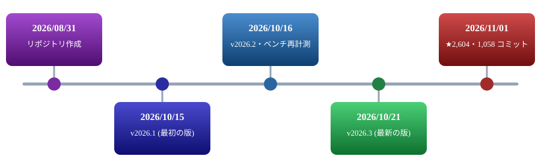

図2. 公開からの経過 (日付は JST。間隔は等分で、実際の日数比ではない)

| 項目 | 内容 |
|---|---|
| 設計 | Wouter van Oortmerssen (言語設計・コンパイラ設計・コーディング規約) |
| 実装・文書 | Claude Fable (コンパイラ実装・ベンチマーク・サンプルと文書の執筆)。README の記載 |
| ライセンス | Apache License 2.0 |
| コンパイラ | 約 3 万行の C++ (README の記載)。出力は C |
| 最新リリース | v2026.3 (2026/10/21)。Windows x64 ・ Linux x64 ・ macOS (Apple silicon と Intel) |
| リポジトリの規模 | ★2,604 ・ 1,058 コミット (2026/11/01 に GitHub API で取得)。最多のアカウントは 983 件で、AI 実装分を含みうる (内訳は未確認) |
| リポジトリの構成 | `src` (コンパイラ) ・ `stdlib` ・ `samples` ・ `test` ・ `bench` ・ `docs` ・ `vscode` ・ `tree-sitter` ・ `third_party` |


図3. 設計と実装の分担 (README の「History & Use of AI」より)

> [!NOTE]
> <strong>AI が実装した新言語という実験でもある。</strong>README は「既存の言語を再現するのではなく、新しい言語を AI に実装させる実験」とも書く。コードが AI 製であることは、品質の良し悪しを直接示さない。判断材料は、テスト・CI・再現できるベンチマークの有無になる (第 8・9 章)。

## 3. ヒープのないメモリモデルと安全性

Goose のプログラムが持つメモリは 3 種類だけ。ネイティブのコールスタック、静的データ、N 本のデータスタック (N はコンパイラが決める)。**これ以外のメモリは存在しない**。

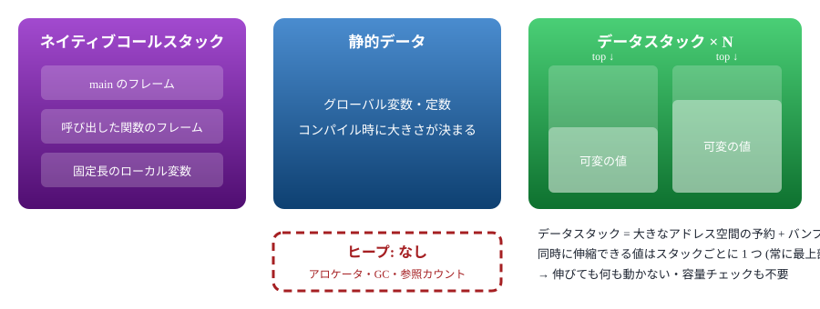

図4. Goose のメモリ領域。ヒープに相当するものはなく、可変の値はデータスタックの最上部に置く

### 解放は 1 回の書き込み

データスタックは大きなアドレス空間を予約し (既定 2 GB。`--stack-reserve` で変更可)、使った分だけ確保 (commit) する。伸長はバンプポインタを進めるだけ。スコープを抜けると、ポインタを戻す 1 回の書き込みで、入れ子の深さや要素数に関係なく解放が終わる。実行時に追跡するのはバンプポインタだけで、残りはコンパイル時に証明する。

```text
for round in 3 {
    var scratch: u8[>..] = [];                        // 伸長のみの配列: 伸ばすのはポインタを進めるだけ
    for i in 100000 { scratch.push((i % 256) as! u8); }
    print("round ", round, ": ", scratch.len, " bytes");
}                                                     // 解放: スタックトップへの 1 回の書き込み
```

出典は公式 README。このコード片そのものは未実行 (動作の確認は第 9 章のサンプルによる)。


図5. データスタックの伸長と解放。個々の要素を走査せず、トップポインタを戻すだけで済む

### 参照は動かず、伸びても無効にならない

1 本のスタックに伸縮できる値は 1 つしか載らず、常に最上部にある。そのため伸長しても既存の要素は移動しない。README は「参照は伸長のあとも有効」を、性能の利点の 1 つに挙げる。`push` は新しい要素への参照を返すので、構築しながら要素同士をつなげられる。

```text
struct Item { id: i32, weight: f32 }

var items: Item[>..] = [];
let first .= items.push(Item { 1, 0.5 });             // 要素 0 への参照
for i: i32 in 2..1000001 { items.push(Item { i, 0.0 }); }
first.weight = 99.5;                                  // 100 万回 push したあとも有効
```

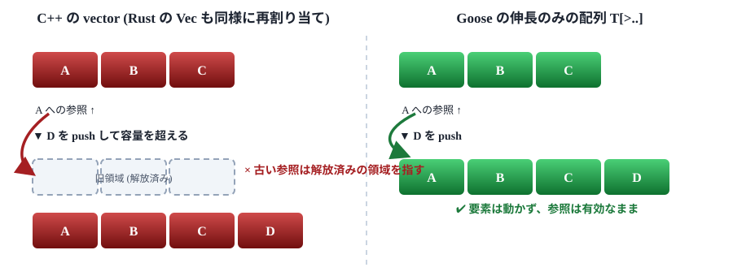

図6. 伸長したときの参照。再割り当てする方式では古い参照が無効になる。Goose は要素を動かさない

### 注釈なしで、参照の寿命を守らせる

すべての参照とスライスには静的な「ルート」(その指す先の寿命を決める変数) がある。参照は、ルートの所有者より長生きできない。コンパイラがルートを推論し、関数をルートごとに特殊化するので、ライフタイム注釈は要らない。エイリアスや排他性の規則もなく、`unsafe` もない。違反はコンパイル時に、ルートと代入先を示して拒否される。

```text
fn longest(a: u8[:], b: u8[:]) -> u8[:] { if a.len >= b.len { a } else { b } }

var outer: u8[>..] = [];
var w = outer[..];
{
    var inner: u8[>..] = [];
    format(inner, "inner text");
    w = longest(outer, inner);     // エラー: inner をルートとする参照を、より長生きする w へ格納
```


図7. 参照のルート。内側の変数をルートとする参照は、外側の参照へ格納できない

スライス `T[:]` は、どの種類の配列からも要素をコピーせずに範囲を受け取る。`split` は入力へのスライスを返し、`u8[:]` をキーにした辞書は文字列のコピーではなくビューを保持する。

## 4. データの置き方

Goose には「配列型」が 1 つだけあるのではなく、**サイズの変わり方だけが違う配列型の一族**がある。どれも `[メタデータ][要素…]` の形で、インラインに詰めて置く。要素の外側に別ブロックへのポインタを持たない。


図8. 配列型の一族 (公式 README の表より)。ほかに、どの配列からもコピーなしで範囲を受ける `T[:]` (スライス) がある

### 文字列は u8 の配列

文字列専用の型はなく、`u8` の配列で表す。使い分けは配列の種類で決まる。

- `u8[>..]`: 組み立て中の文字列 (ビルダー)
- `u8[]`: 完成した文字列。それを持つ構造体や配列の中にインラインで置く
- `u8[..16]`: 構造体の中に収まる小さな文字列
- `u8[:]`: 文字列のビュー

### 入れ子のデータが 1 つの連続ブロックになる

構造体が可変サイズの部分を含むと、それらは宣言順にインラインで並ぶ。注文 1 件は「バイト列」であり、中にポインタがない。

```text
struct Item  { sku: u8[varint], qty: varint, cents: varint }
struct Order { id: varint, customer: u8[varint], items: Item[varint] }

var book: Order[>..] = [];
book.push(Order { id: 1001, customer: "alice",
                  items: [Item { sku: "SKU-441", qty: 2, cents: 1999 },
                          Item { sku: "SKU-7", qty: 1, cents: 500 }] });
```

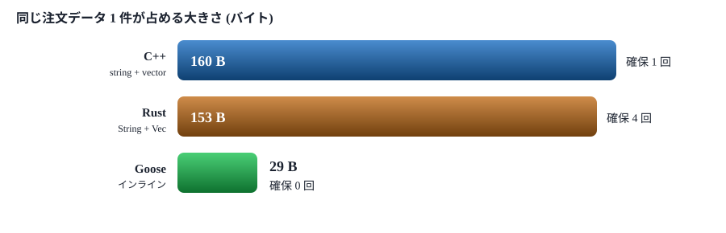

図9. 同じ注文データの大きさと確保回数 (公式 README の数値。作者側の計測で、当方では未再計測)

> [!NOTE]
> <strong>代償は添字アクセス。</strong>可変サイズの要素を持つ配列は、先頭から順に走査できるが、添字では引けない。添字で引きたいときは、参照の配列を別に持って索引にする。

### enum は 2 つの大きさで持てる

代数的データ型 (ADT) は動的な多態の唯一の形で、継承も vtable もない。同じ ADT を、使う場所で 2 通りに格納できる。

- **固定モード** (`Shape`): タグと、最大のバリアントの分だけの領域を持つ。添字で引け、上書きもできる
- **可変モード** (`Shape..`): 各値がそのバリアントの実サイズだけを占める。配列は逐次的になり、値のバリアントは変えられないが、ペイロードの中への参照を取れる

```text
enum Shape { Circle { r: f64 }, Rect { w: f64, h: f64 }, Dot }

var packed: Shape..[>..] = [];                 // 9・17・1 バイト (17 バイト × 3 ではない)
packed.push(Shape.Circle { r: 1.0 });
packed.push(Shape.Rect { w: 2.0, h: 3.0 });
packed.push(Shape.Dot);
```

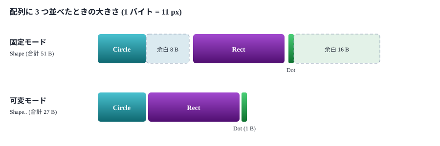

図10. 固定モードは最大のバリアント (17 B) に合わせて余白が出る。可変モードは各値の実サイズだけ

バリアントごとに関数を定義する「ケース関数」で、タグに応じた呼び分け (ジャンプテーブル) も書ける。コンパイラが全バリアントを網羅しているかを検査する。

### ポインタより狭いリンク (相対参照)

通常の参照 `T&` は 8 バイトの機械アドレス。**相対参照**は同じリンクを 1・2・4 バイトのオフセットで持つ。`T&<u32>` は、フィールド自身から同じ配列内の対象までの距離で、配列全体が位置に依存しない。オフセット 0 を null として使えるのは `T&<u32>?`。

```text
struct Node { key: i32, left: Node&<u32>?, right: Node&<u32>? }   // リンク込みで 12 バイト

var image: u8[>..] = tree.to_bytes();           // 配列全体のバイト列
var loaded, ok = from_bytes<Node[>..]>(image);  // 検証してから値になる
```

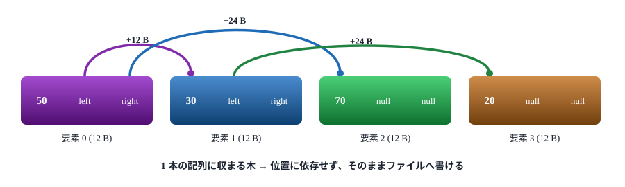

図11. 相対参照による二分探索木 (模式図)。リンクは自分の位置からの距離なので、配列をどこへ置いても意味が変わらない

`from_bytes` は、枠・タグ・長さ・リンクをすべて検査してから値にする。壊れた、あるいは悪意のあるファイルは、不正な参照ではなく `false` を返す。保存はバイト列を書くだけ、読み込みは読んで検証するだけで、シリアライザもスキーマもポインタの付け替えも要らないというのが README の主張。

## 5. 言語機能 (エラー・ジェネリクス・スレッド・C)

### エラーを何段上へでも返す: `return E from f`

`return E from f` は、関数 `f` の最も内側の有効な呼び出しの結果として `E` を返す。途中の関数は通常のシグネチャのまま。静的に検査され、`parse_user` の呼び出しはすべて `load` の呼び出しの内側になければならない。実装は、各フレームで検査する隠しの判別値で、アンワインダは使わない。

```text
fn load(text: u8[:]) -> User[>..], u8[] {
    var users: User[>..] = [];
    each_split(text, '\n') { users.push(parse_user(it)); };
    return users, "";
}

fn parse_user(line: u8[:]) -> User {              // User を返す: Result もエラー引数もない
    let comma = find(line, ",");
    guard comma >= 0 else { return [], str("expected name,age: ", line) from load; }
    ...
}
```

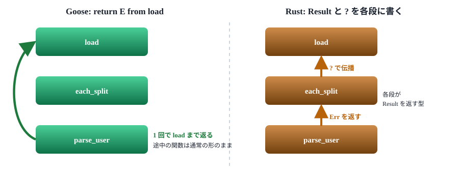

図12. エラーの返し方。Goose は静的に検査された 1 回の戻りで済む。Rust は各段のシグネチャと `?` で受け渡す

### ジェネリクスと、消えるブロック

型を書かないパラメータは、そのままジェネリクスになる。関数値はコンパイル時の存在で、クロージャオブジェクトも関数ポインタもない。そのため、高階関数は手書きのループと同じコードに展開される。ブロックの中の `return` は、そのブロックを囲む関数から返る。

```text
fn twice(x) { x + x }                              // 型なしのパラメータはジェネリック

fn each_pair<T, F>(xs: T[:]) {                     // F は関数値 (コンパイル時の実体)
    for i in 0..xs.len - 1 { F(xs[i], xs[i + 1]); }
}

let evens = xs.filter() { it % 2 == 0 };           // 結果は evens へ直接構築 (一時領域なし)
let total = fold(xs, 0) { acc, x => acc + x };
```

すべて単相化される。結果を返すときも、呼び出し側の変数へ直接構築する「その場構築」が保証される。`words.push(str("word", i))` は、整形した文字列を新しい要素へ直接書き込む。

### 共有メモリのないスレッド

`thread_fn` とそこから呼ばれるものは、**独立したプログラムとしてコンパイル**され、自分のデータスタックとグローバルのコピーを持つ。値は型ごとのキューで渡し、参照を含まない「平坦な」値に限る。平坦な値は連続しているので、渡すのは 1 回の `memcpy`。データ競合・ロック・アトミック・メモリオーダリングは、言語に存在しない。

```text
thread_fn worker() {                                // 独立したプログラム。自分のメモリを持つ
    loop {
        let job = qget<Job>();                      // Job の型付きキューで待つ
        guard job.n >= 0 else { break; }            // -1 は停止の合図
        qput(Result { n: job.n, digits: count_digits(job.n) });
    }
}
for i in n { ids.push(thread_spawn(worker)); }
```

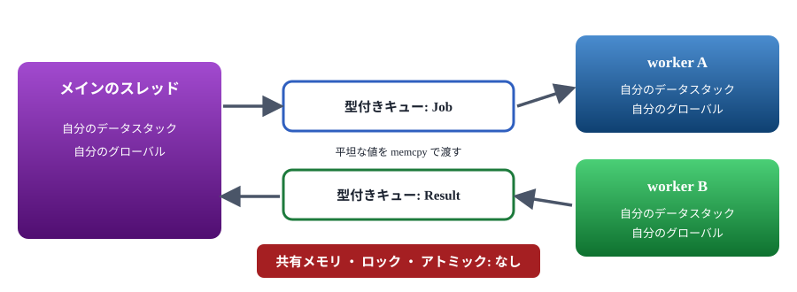

図13. スレッド間は型付きキューだけでつながる。各スレッドが自分のメモリを持つ

worker は `thread_spawn_contained` で起動すると、失敗した検査や `abort` がその worker だけを終わらせる。メッセージは標準エラーではなく、待っている側へ届くので、監督役がログに残して作り直せる。

### C との連携

`extern fn` が、Goose のシグネチャを C のシンボルに結びつける。スライスは `{ data, len }` として渡り、構造体はポインタ経由で埋められる。`math` と `os` のモジュールがこの仕組みを使う。C 側から Goose を呼ぶ手順も、チュートリアルにある (第 19 節。当資料では未確認)。

```text
extern fn hypot(x: f64, y: f64) -> f64;             // libm からそのまま
extern fn crc32_bytes(s: const u8[:]) -> u32;       // スライスは { data, len } で渡る
```

このページのコード片は、いずれも公式 README からの引用で、そのものは未実行 (動作の確認は第 9 章のサンプルによる)。

## 6. 実行の仕組みと使い方

コンパイラは、プログラム全体を 1 つの C ファイルへ出力する。その C を、同梱の TinyCC でコンパイラ自身のプロセス内で実行するか (ビルド手順なし)、システムの C コンパイラでネイティブの実行ファイルにする。

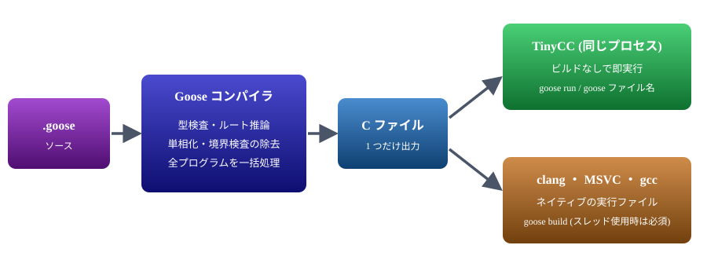

図14. コンパイルと実行の流れ。同じ C を、TinyCC かシステムの C コンパイラへ渡す

### 主なコマンド

| コマンド | 動作 (公式 README の記載) |
|---|---|
| `goose file.goose` ・ `goose run` | ソースから直接、同一プロセス内で実行。C コンパイラもビルド手順も不要 |
| `goose build file.goose` | ソースの隣に実行ファイルを出力。C コンパイラを探して使う (`goose toolchain` で確認) |
| `goose check` | 型検査だけ |
| `goose -o tour.c tour.goose` | C のソースを書き出す (自前のビルドや C のホスト向け) |
| `--debug` | オーバーフロー・範囲・タグの検査を有効にする。失敗時にソース行を示す |
| `--bce-lines` | 残っている境界検査を行ごとに報告する |
| `--stack-reserve 16G` | データスタックの予約サイズを変える (既定 2 GB) |
| `goose lsp` | 言語サーバ。エラー表示・ホバー・定義へ移動・補完・リネーム。VS Code 拡張と、Neovim ・ Helix ・ Emacs の設定例がある |

### 導入の前提

| OS | プログラムの実行のみ | goose build |
|---|---|---|
| Windows x64 | 追加の導入は不要 | Visual Studio 2022 以降または clang |
| Linux x64 | C ライブラリのヘッダ (`libc6-dev` または `glibc-devel`)。glibc 2.35 以降 | gcc または clang |
| macOS (arm64 ・ x64) | Xcode コマンドラインツールの SDK。macOS 13.3 以降。ダウンロードした zip は `xattr -dr com.apple.quarantine` が必要 | gcc または clang |

- **配布物の中身**: コンパイラ・標準ライブラリ・TinyCC のランタイム・パッケージ (gfx ・ audio ・ ui ・ physics)・文書・サンプル・VS Code 拡張。ビルド結果は `~/.goose` (`GOOSE_HOME`) に置く
- **標準ライブラリ**: 14 モジュール。すべて読める Goose で書かれている。`gfx` は SDL3 の GPU API、`physics` は Box3D、`ui` は Nuklear の上に作られている
- **パッケージ**: `import name from "owner/repo@v1";` で git のリポジトリを取得し、`~/.goose` にビルドする
- **ソースからのビルド**: CMake 3.27 以降、C++20 のコンパイラ、テストとサンプルの実行用に Python 3

> [!NOTE]
> <strong>スレッドを使うプログラムは `goose build` が必須。</strong>TinyCC はスレッドローカルストレージを置けないため、同一プロセス内の実行 (JIT) では動かない。実際にサンプルの `mandelbrot_threads` は、JIT では「JIT mode does not support threads yet」と返り、`goose build` では動いた (第 9 章)。

## 7. C++・Rust・Go・JavaScript との比較

観点ごとに並べる。Goose の欄は公式資料の記載、他の言語の欄は一般に知られた言語の性質。**公式ベンチマークに含まれる比較先は C++ と Rust だけ**で、Go と JavaScript は含まれない (第 8 章)。

| 観点 | Goose | C++ | Rust | Go | JavaScript |
|---|---|---|---|---|---|
| 実行方式 | C へ出力。TinyCC で同一プロセス実行、または C コンパイラでネイティブ化 | ネイティブへコンパイル | ネイティブへコンパイル (LLVM) | ネイティブへコンパイル (ランタイム同梱) | JIT を持つエンジン上で実行 |
| メモリの管理 | データスタック。スコープ終了で解放 | 手動と RAII (スマートポインタ) | 所有権と借用 (`Vec` ・ `Box` は通常のヒープ) | GC (ヒープ) | GC |
| メモリ安全 | コンパイラが保証。`unsafe` なし | 言語は保証しない (未定義動作) | 安全な Rust で保証。`unsafe` がある | GC と境界検査で概ね安全。データ競合や `unsafe` パッケージは別 | 安全 (範囲外は例外や `undefined`) |
| 寿命の注釈 | 不要 (ルートを推論) | 不要 (規律で守る) | 必要な場面がある | 不要 | 不要 |
| 動的データの置き場 | 入れ子もインラインの連続ブロック | 要素ごとに別のヒープ領域 | 同左 (`String` ・ `Vec` は個別に確保) | GC ヒープ | GC ヒープのオブジェクト |
| 配列が伸びたときの参照 | 有効のまま | 再割り当てで無効になる | 借用規則がコンパイル時に拒否する | `append` で別の配列になることがあり、古いスライスは旧配列を指す | 要素への「参照」を持たない |
| エラー処理 | `return E from f` (何段でも直接戻る) | 例外または戻り値 | `Result` と `?` | 戻り値 (`error`) | 例外 (`throw`) |
| 並行処理 | 共有メモリなし。型付きキューで `memcpy` | スレッドと共有メモリ (ロック・アトミック) | スレッド。所有権でデータ競合を防ぐ | goroutine と channel (共有メモリも使える) | シングルスレッドとイベントループ。Worker はメッセージ渡し |
| 多態 | ADT のタグだけ。継承も vtable もない | 継承・仮想関数・テンプレート | trait (静的と `dyn`) | interface | 動的 (プロトタイプ) |
| ジェネリクス | 単相化。型なしの引数がそのまま総称になる | テンプレート | 単相化 (`dyn` も可) | 型パラメータ | 動的型のため不要 |
| 成熟度 | 公開から約 2 か月。ライブラリ資産はほぼない | 数十年。巨大な資産 | 1.0 は 2015 年。大きな資産 | 1.0 は 2012 年。大きな資産 | 非常に大きな資産 |
| 公式ベンチでの比較 | — | ✅ **あり** | ✅ **あり** | ⬜ **なし** | ⬜ **なし** |

Goose 以外の列は、当資料では実機で確かめていない一般知識。数値の比較ではなく、設計の違いを並べたもの。

### 解放を、いつ、誰が決めるか

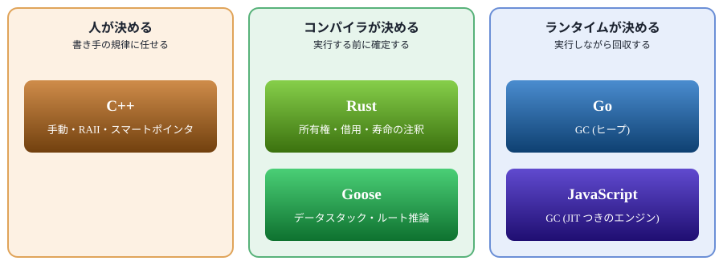

図15. 解放を決める主体による分類。Goose と Rust は実行前に決めるが、Goose はヒープ自体を持たない

### ぶら下がった参照を、どう防ぐか

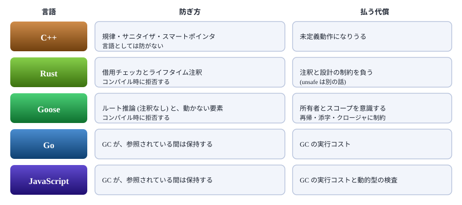

図16. ぶら下がった参照の防ぎ方と、その代償

### Go と JavaScript について

公式ベンチマークに Go と JavaScript の比較はない。確認した 5 つのベンチ群の README (`plb` ・ `plb2` ・ `kostya` ・ `kostya2` ・ `bddicken`) にも、Go や JavaScript と比べた記述は見つからなかった。比較先はいずれも C と C++ と Rust。

> [!NOTE]
> <strong>以下は見立てで、実測していない。</strong>Go と JavaScript は、どちらもヒープ上のオブジェクトを GC が回収する。小さな構造データを大量に作って捨てる処理では、確保と回収のコストがかかる。Goose はその部分を、連続配置とスコープ終了時の一括解放で省く。逆に、長く生きる複雑なグラフや、既存ライブラリを使い倒す処理では、Go や JavaScript が有利になりうる。

### 実測するなら

提案だけで、まだ実施していない。同じアルゴリズムを Goose ・ C++ ・ Rust ・ Go ・ Node.js で書き、全体の経過時間と最大メモリを同じ条件で測る。土台には、作者が Goose 版を用意している `plb2` の 4 タスク (`nqueen` ・ `matmul` ・ `sudoku` ・ `bedcov`) が使える。Go と Node.js がこの環境に入っているかは未確認。

## 8. 性能の主張とその読み方

数値はすべて、リポジトリの `bench` に置かれた作者側の測定結果 (2026/10/16 生成)。当資料では再計測していない。

### 全体の結果 (16 本の幾何平均)

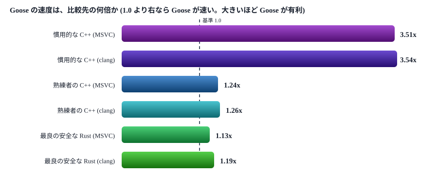

図17. 速度の幾何平均 (16 本、large サイズ)。出典は公式の bench/results.md。1.0 を基準に棒を描いた

ピークメモリは、慣用的な C++ に対して 1.95 倍、熟練者の C++ に対して 1.32 倍、最良の安全な Rust に対して 1.25 倍少ない (いずれも Goose が少ない側)。

| 測定条件 | 内容 (bench/results.md の記載) |
|---|---|
| マシン | AMD Ryzen 9 9950X3D (16 コア) ・ RAM 94 GB ・ Windows 11 |
| コンパイラ | MSVC 19.51.36260 (`/O2`) ・ clang-cl 22.1.3 (`/O2`) ・ rustc 1.98.0 (`-O -C codegen-units=1`)。Goose は C を出して、各コンパイラで同じ C をビルド |
| 方式 | 3 回の最良値 (事前に 2 回捨てる)。プロセス全体の経過時間で、入力の生成・構築・破棄を含む。全実装が同じチェックサムを出すことを確認 |
| 空プロセスの床 | Goose 13.1 ms ・ C++ 13.8 ms (小さなサイズでは比率に影響する) |

### 16 本の内訳 (Rust との比較)

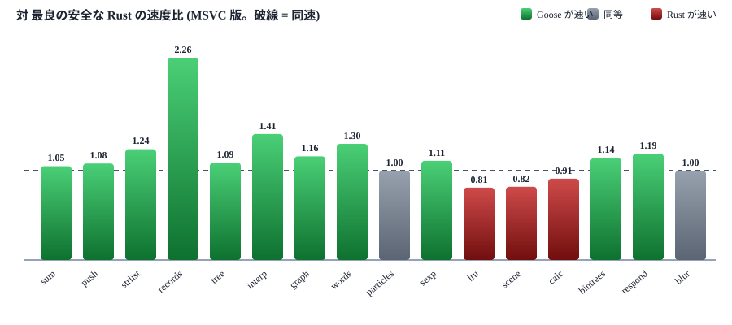

図18. ベンチマーク 16 本の対 Rust の速度比 (MSVC 版)。3 本 (lru ・ scene ・ calc) は Rust が速い

### 勝つところと負けるところ

| ベンチ | 対 Rust の速度 (MSVC / clang) | 対 Rust のメモリ | 作者の説明 (bench/summary.md) |
|---|---|---|---|
| `records` | ✅ **2.26x / 2.02x** | 3.98 倍少ない | 可変モードの enum が、各レコードを実サイズで (文字列もインラインで) 持つ |
| `interp` | ✅ **1.41x / 1.29x** | 2.04 倍少ない | 木構造で同じ違いが出る |
| `graph` | ✅ **1.16x / 1.32x** | 同じ | 境界検査なしの走査 (`checkfree`) と、4 バイトの頂点 ID。構築と検証の時間も含む |
| `lru` | ❌ **0.81x** / ✅ **1.09x** | 1.03 倍少ない | MSVC では負け、clang では勝ち |
| `scene` | ❌ **0.82x** / ⚠️ **1.02x** | 1.35 倍少ない | MSVC では負け、clang ではほぼ同等 |
| `calc` | ❌ **0.91x / 0.89x** | 同じ | 481 / 491 ms 対 Rust のアリーナ 436 ms |

### 読むときの注意

- **作者側の測定**。1 台のマシンで、コア固定なし。差の小さい項目は誤差の範囲で、summary も同じ注意を書いている
- **「慣用的な C++」の定義**は、`unique_ptr` ・ `vector<string>` ・ `unordered_map` ・ `std::variant` を素直に使う書き方。「熟練者の C++」は、予約済みアリーナと添字・`string_view` ・ 平坦なオフセット・オープンアドレス法・CSR を使う書き方。倍率は、この定義に左右される
- **集計は「最速の Goose 実装」の寄せ集め**。比較ごとに最速の Goose 実装を選び、メモリは別に最小の実装を選ぶ。1 つの実装がすべての最良値を満たすわけではない (summary の記載)
- **Rust は rustc 1 種類** (LLVM)。Goose と C++ は MSVC と clang の 2 種で比べている
- **日付をまたぐ比較は原因を特定できない**。空プロセスの床や MSVC の版が前回の報告から変わっていて、差のすべてを Goose の改善とは言えない、と summary 自身が書く

> [!NOTE]
> <strong>README の中で数値が食い違っている。</strong>冒頭の「Why Goose」は 3.3 倍 ・ 1.16 倍 ・ 1.12 倍 (メモリは 1.9 倍 ・ 1.3 倍 ・ 1.2 倍)、後半の表と bench/summary.md は 3.51 倍 / 3.54 倍 ・ 1.24 倍 / 1.26 倍 ・ 1.13 倍 / 1.19 倍 (メモリは 1.95 倍 ・ 1.32 倍 ・ 1.25 倍)。結果ファイルの生成日 (10/16) から、後半が新しいと見られるが、確認していない。当資料は後半の値を使った。

### ほかのベンチ群

作者は、既存の多言語ベンチマークの Goose 版も `bench` に置いている (`plb` ・ `plb2` ・ `kostya` ・ `kostya2` ・ `bddicken`)。各 README を読んだ範囲では、比較先は C と C++ と Rust。`plb2` は `nqueen` ・ `matmul` ・ `sudoku` ・ `bedcov` の 4 タスクで、C は clang `-O3 -fwrapv -flto`、Rust は `opt-level=3`、Goose が出す C も clang `-O3` でビルドする。出力は C の結果と照合してから時間を測る。

## 9. 動くのか (確認した範囲)

**動く。リリース版の goose.exe で、同梱のサンプル 31 本を実行し、期待出力との一致を確認した** (JIT で 30 本、ネイティブビルドで 31 本)。確認できたことと、できなかったことを分けて示す。


図19. 動作確認の段階。1〜5 は確認、6 は未実施

| 項目 | 結果 | 根拠 |
|---|---|---|
| 公式リリース | ✅ **✅ 確認** | v2026.3 (2026/10/21) に 4 種のアーカイブ。ほかに v2026.1 (10/15) ・ v2026.2 (10/16) |
| zip の取得と中身 | ✅ **✅ 確認** | Windows x64 版を取得し、SHA-256 の先頭は `e30cfa39`。公式はハッシュを公開しておらず (アーカイブ 4 つのみ)、突き合わせは不能。展開すると `goose.exe` ・ `stdlib` ・ `tcclib` ・ `pkg` ・ `samples` ・ `docs` ・ `vscode` ・ `licenses` |
| CI | ✅ **✅ 確認** | 2026/11/01 09:29 (JST) 開始の push 実行が成功 (約 11 分)。4 ジョブ: macOS ・ Ubuntu ・ Windows の baseline と、Linux の ASan + UBSan。同じ日の pull_request の実行には、承認待ち (`action_required`) が 1 件ある |
| サンプル | ✅ **✅ 存在** | リリース版の `samples` に 31 本 (01〜31)。リポジトリの master には、リリース後に 32 本目 (`pool_worker_snapshots`) が足されている。期待出力は `samples/expected` に 31 本、実行用に `run_samples.py`。README の「31 本」は、リリース版の本数と合う |
| テスト | ✅ **✅ 存在** | `test` に 47 エントリ (配下のファイルは 3,858 個)。実行は `python test/run_tests.py` (README の記載) |
| goose.exe の実行 | ✅ **✅ 確認** | リリース v2026.3 の Windows 版で、公式ランナー (`run_samples.py`) と同じ呼び方により、同梱サンプル 31 本を実行し、標準出力を `samples/expected` と照合した。**JIT** (`--jit`) は 30 本が一致。残る `mandelbrot_threads` は、スレッド使用のため JIT 非対応と返った (仕様どおり)。**ネイティブ** (`goose build` して実行) は 31 本すべて一致 |
| 窓を開くサンプル | ✅ **✅ 確認** | `gfx_cube` ・ `physics_boxes` ・ `ui_todo` ・ `mini_minecraft` ・ `mini_doom` の 5 本は、窓を開かない指定 (`GOOSE_GFX_HEADLESS=1`) と、`--frames 30` などの引数つきで実行し、期待出力と一致した |
| 実行環境 | ⬜ **参考** | Windows 11 ・ MSVC 19.35 (Visual Studio 2022)。コンパイラに内蔵されたパッケージは physics ・ gfx ・ audio ・ ui |
| ベンチの再計測 | ⬜ **⬜ 未実施** | 実行時間は取っていない (サンプルの一致の確認が目的)。Go ・ JavaScript は、そもそも比較対象のベンチがない |

### サンプルの内容

ファイル名からの分類 (当方の整理)。「小さな言語の紹介」にとどまらず、グラフィックスやゲームまで含む。

| 分類 | サンプル |
|---|---|
| 言語の入門 | 01 tour ・ 02 memory ・ 03 strings ・ 04 errors ・ 05 shapes ・ 06 functions |
| アルゴリズム | 07 sieve ・ 08 bignum ・ 09 sorting ・ 10 sudoku ・ 11 maze ・ 12 huffman |
| データ構造 | 13 linked_list ・ 14 bst ・ 15 word_freq ・ 16 records |
| パーサと VM | 17 calc ・ 18 json ・ 19 vm |
| シミュレーションと画像 | 20 life ・ 21 raytrace ・ 22 image_filters ・ 23 mandelbrot_threads |
| C 連携と保存 | 24 call_c ・ 25 serialize ・ 26 file_tree ・ 32 pool_worker_snapshots (32 は master にのみある) |
| グラフィックスとゲーム | 27 gfx_cube ・ 28 physics_boxes ・ 29 ui_todo ・ 30 mini_minecraft ・ 31 mini_doom |

> [!NOTE]
> <strong>確認の範囲。</strong>確認したのは、サンプルの標準出力が期待出力と一致し、終了コードが 0 であることまで。実行時間・メモリ・安全性の保証 (範囲外参照の拒否など) は検証していない。また、期待出力は公式ランナーの `--bless` で、実装の出力から作れる。一致は「前回と同じ出力が出る」ことを示すが、出力が仕様として正しいことまでは保証しない。

## 10. 限界と向き不向き

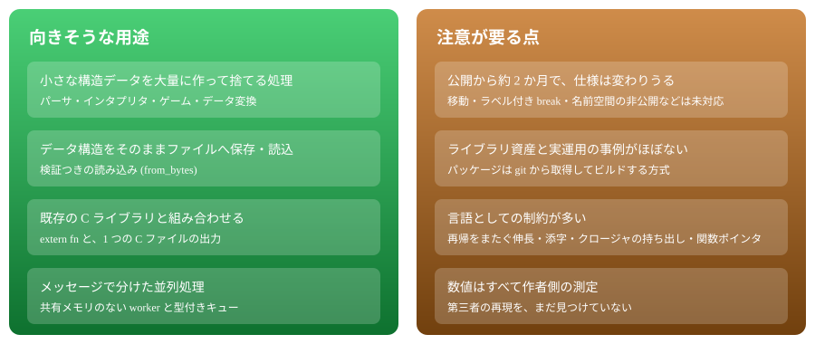

図20. 向きそうな用途と、注意が要る点

### README が挙げる制限

- データがどこに住み、誰が所有し、スコープがどこまで続くかを、書き手が考える必要がある。多くは「データを組み立てる関数が所有者」で追加の作業は要らないが、そうでないときは `slot_pool` か `slice_pool` を使う
- 再帰関数は、再帰呼び出しをまたいで伸長できるデータを持てない。作業用のデータは呼び出しの前に終え、呼び出しより長く生きるデータはプールとして渡す
- 可変サイズの要素を持つ配列は、走査はできるが添字では引けない。固定モードの enum は中身を指せず、可変モードの enum は上書きできない。この選択はコンテナごとに決める
- エスケープするクロージャ・関数ポインタ・ADT のタグ以外の動的ディスパッチはなく、全プログラムのコンパイルだけに対応する
- プールへ返したのにまだ参照されている場所は、次の持ち主が置いた値を読む。論理的なバグだが、メモリ破壊にはならない

### 結論

- **どういう言語か**: ヒープと GC を持たず、データスタックと「動かない参照」で、注釈なしにメモリ安全を狙う C 出力のシステム言語
- **動くのか**: 動く。リリース版の goose.exe で、同梱サンプル 31 本が期待出力と一致した (JIT で 30 本、ネイティブで 31 本)。3 OS の CI も成功している。性能と安全性の保証は検証していない
- **他言語との違い**: C++ と Rust にはベンチマーク上の比較がある (作者側の測定)。Go と JavaScript とは、設計の違いを定性的に並べただけで、実測の比較はない
- **採るかどうか**: 実験として面白く、特定の用途 (構造データの大量処理) には筋が良い。業務の基盤にするには、若さとライブラリ資産の少なさが壁になる

### 次の一手 (提案)

1. サンプルのうち数本の出力を人が読み、仕様どおりか確かめる (期待出力は実装から作れるため)
2. 同じアルゴリズムを Goose ・ C++ ・ Rust ・ Go ・ Node.js で書き、時間とメモリを同条件で測る
3. 自分の用途に近い小さなプログラムを 1 本書き、制約が障害になるかを見る

### 同名の別物

- [goose-lang/goose](https://github.com/goose-lang/goose): Go のサブセットを Rocq (Perennial) へ変換する検証ツール。言語ではない
- [calico32/goose](https://github.com/calico32/goose): Go の上に作られた小さな言語
- pressly/goose: データベースのマイグレーションのツール
- Block 社の goose: AI エージェント

### 出典

- [aardappel/goose の README](https://github.com/aardappel/goose/blob/master/README.md)
- [チュートリアル](https://github.com/aardappel/goose/blob/master/docs/tutorial.md)
- [ベンチマークの全結果 (bench/results.md)](https://github.com/aardappel/goose/blob/master/bench/results.md) ・ [要約 (bench/summary.md)](https://github.com/aardappel/goose/blob/master/bench/summary.md)
- [plb2 の Goose 版 (bench/plb2/README.md)](https://github.com/aardappel/goose/blob/master/bench/plb2/README.md)
- [サンプルの案内 (samples/README.md)](https://github.com/aardappel/goose/blob/master/samples/README.md)
- [リリース v2026.3](https://github.com/aardappel/goose/releases/tag/v2026.3)
- リポジトリの値 (星・コミット数・CI の状況) は 2026/11/01 に GitHub API で取得

### 課題

- [課題 (issues)](notes/40_issues/issues.md)

[親へ戻る](../)
